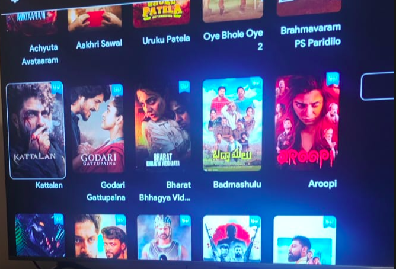

<h1 align="center">MovieLens</h1>

Point your phone at a movie poster or a TV catalogue, tap once, and see its live IMDb rating.

## What it shows

- **IMDb rating** and **vote count** (e.g. `8.8 /10 · 2.6M votes`)
- **Type** (Movie / TV Series / …)
- **Year**, or the years a series ran (`2019 – present`)
- **Age badge**: `ALL`, `+7`, `+10`, `+13`, `+14`, `+18`, or `NR` (not rated). US and Indian certificates are both understood.
- **Genres**
- Tap the card to open the title in the IMDb app or the browser

## How it works

1. **Frame.** An on-device ML Kit object detector finds the poster-shaped tile under the centre of the screen. A Lens-style frame snaps onto it: the rest of the screen dims, with corner brackets and a moving dashed border. If no tile is detected, a fixed frame stays in the middle.
2. **Identify.** Tap the ✦ shutter, or tap a poster directly. The framed poster, plus a strip above and below for caption titles, goes to Claude (`claude-opus-5-5`). Claude names the title and uses web search on imdb.com to fetch the current rating, votes, genres and certificate. The answer comes back as structured JSON.
3. While it works, the shutter shows a spinning ring and a scan line sweeps the poster.

## Setup

1. Get a Claude API key at <https://console.anthropic.com>
2. Build with `./gradlew assembleDebug`, then put `app/build/outputs/apk/debug/app-debug.apk` on your phone.
3. Enter the key on first launch. Long-press the top pill to change it later. The key is stored only on the device.

Requires an arm64 Android 7.0+ (API 24) phone, and JDK 17+ to build.

## Limitations

- Each identification is a paid Claude call with web search and takes a few seconds, so it runs on tap, not continuously.
- On very busy screens the detector may not isolate a tile; just fit the poster inside the default frame.
- The API key lives on the phone. Fine for personal use; put a small proxy server in front before sharing the app widely.
