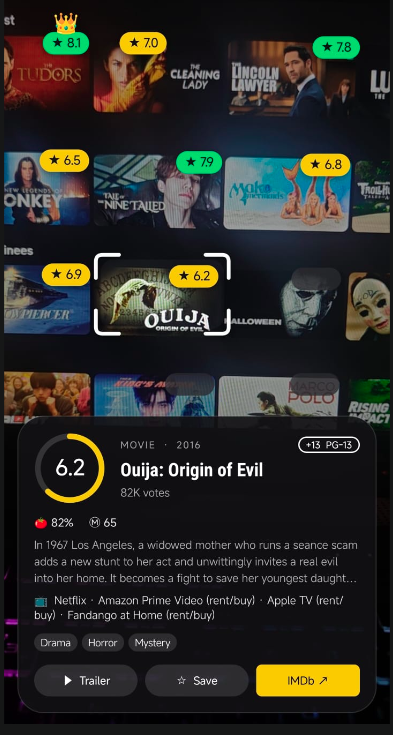

<h1 align="center">MovieLens</h1>

Point your phone at a streaming catalogue or a wall of posters. Every title gets its IMDb rating, live, with no buttons to press.

## What it does

- **Rates everything in view.** Hold the phone steady and every poster gets a rating chip: 🟢 7.5+, 🟡 6–7.4, 🔴 below 6.
- **👑 Best pick.** A crown marks the highest-rated title on screen.
- **Full details for the focused poster.** The one nearest the centre (or the one you tap) gets corner brackets and a card with:
  - IMDb rating ring, vote count, type, year, and age badge (`ALL`, `+7`, `+10`, `+13`, `+14`, `+18`, `NR`; US and Indian certificates)
  - 🍅 Rotten Tomatoes and Ⓜ Metacritic scores
  - A spoiler-free plot
  - 📺 Where to watch in your country
  - Genres, plus **▶ Trailer**, **☆ Save** and **IMDb ↗** buttons
- **↻ Retry** when a rating comes back empty.

From the ☰ menu:

- **★ Watchlist.** Long-press a poster (or tap ☆ Save) to keep it for later.
- **🕘 History.** Every title you've looked up.
- **🎯 Taste filter.** A minimum rating, plus genres you like or want to hide. Posters that don't match fade out.
- **🔞 Parental mode.** +18 titles get a red badge and fade out.

## How it works

1. **Steady detection.** The gyroscope tells when the phone stops moving; moving clears the chips so they never drift off their posters.
2. **Find every title.** One Claude Haiku 5.5 vision call returns each title on screen with its bounding box. Twinkling dots show while it looks.
3. **Fetch details.** Per title, Haiku runs a few web searches (IMDb, Rotten Tomatoes, Metacritic, JustWatch) and returns structured JSON. Four run at once, and each chip fills in as its answer lands.
4. **Remember.** Results are kept on the phone for 3 days, so a screen you've seen before fills in instantly at no cost.

## Setup

1. Get a Claude API key at <https://console.anthropic.com>
2. Build with `./gradlew assembleDebug`, then put `app/build/outputs/apk/debug/app-debug.apk` on your phone.
3. Enter the key on first launch (☰ → API settings later).

Requires an arm64 Android 7.0+ (API 24) phone, and JDK 17+ to build.

### Keep the key off the phone (optional)

`server/proxy.php` forwards the app's requests to Anthropic with the real key, which stays on your server. It only allows `claude-haiku-5-5` on `/v1/messages` and limits each IP to 60 requests per minute.

1. Deploy it on any PHP host with curl and set two environment variables:
   - `ANTHROPIC_API_KEY`: your real key
   - `APP_TOKEN`: any long random string
2. In the app, open ☰ → API settings. Set **Server URL** to `https://your-host/proxy.php` and put the `APP_TOKEN` in the key field.

## Limitations

- Each new screen costs one vision call plus one search call per new title (Haiku pricing). A 12-poster grid is about 13 calls the first time.
- Bounding boxes come from the AI, so chips can sit slightly off on very dense grids.
- Very new or obscure titles may have no IMDb rating yet.
